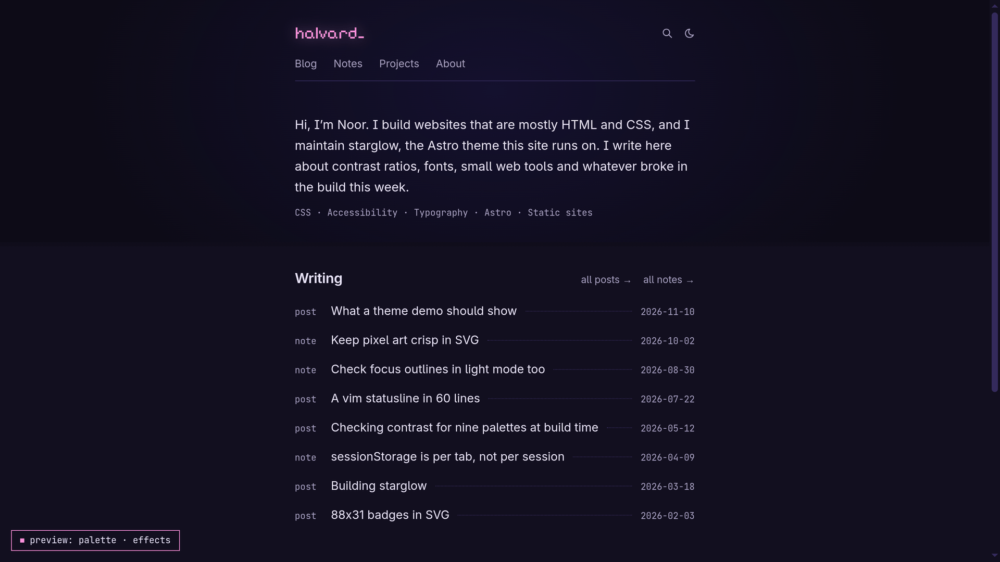
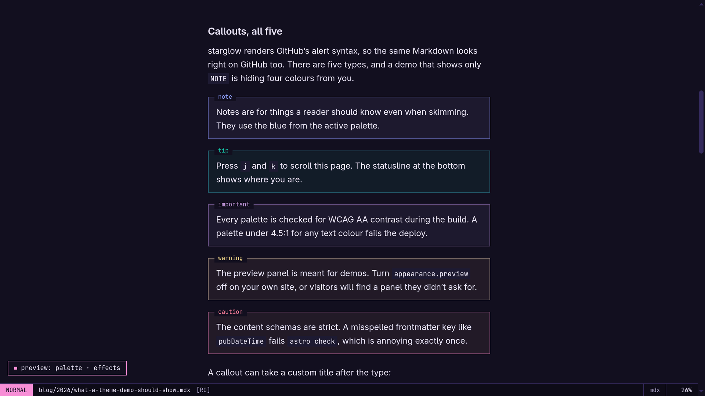
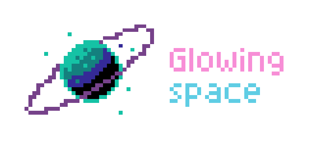

# starglow

A minimal, developer-flavoured Astro theme for blogs, notes and projects.
Dark first, its own colour palettes, a little 2000s glow.

<picture>
  <source media="(prefers-color-scheme: light)" srcset=".github/assets/home-light.png">
  
</picture>

**[Live demo](https://glowing-space.github.io/starglow/)** · [Docs](docs/) · [Releases](https://github.com/glowing-space/starglow/releases)

## Features

- Posts, short notes and projects, with tags and related content
- Banded page header with an optional ambient glow and a pixel wordmark
- Labelled code, table and callout blocks; GitHub alert callouts; MDX
- Optional Obsidian-flavoured Markdown: wikilinks, image embeds, comments
- Vim-style statusline on posts and notes with h/j/k/l keys (off on touch screens and phones), 88x31 footer badges that list each link once, a terminal-style 404 page
- Pagefind search, RSS, sitemap, generated Open Graph images, JSON-LD
- 4 dark and 5 light palettes, chosen separately; your own in a few lines; WCAG AA checked at build
- A live preview panel for demos: palette, ambient light, glow, statusline
- Almost no client JavaScript; plain static `dist/` for any host
- One typed config file, `starglow.config.ts`
- Build checks: every route, canonical URL, search index and link is asserted after each build

## Screenshots

| Dark                                                                                                                                                                                                       | Light                                                                                 |
| ---------------------------------------------------------------------------------------------------------------------------------------------------------------------------------------------------------- | ------------------------------------------------------------------------------------- |
|  |  |


## Quick start

Clone starglow and keep it as a second remote, so theme updates stay one
merge away:

```sh
git clone https://github.com/glowing-space/starglow.git my-site
cd my-site
git remote rename origin starglow
pnpm install
pnpm dev            # http://localhost:4321
```

Prefer Docker? `./dev.sh` runs the same dev server with only Docker on the
host.

Then:

1. Set your details in [`starglow.config.ts`](starglow.config.ts).
2. Replace the example posts, notes and projects in `src/content/` with your
   own. `./dev.sh new post my-first-post` scaffolds one.

## Publish to `<username>.github.io`

1. On GitHub, create an empty repository named `<username>.github.io`.
2. Settings → Pages → Source: **GitHub Actions**.
3. Settings → Secrets and variables → Actions → Variables: add `SITE_URL`
   with `https://<username>.github.io`. Publishing from another repo name
   instead, at `https://<username>.github.io/<repo>/`? Also add `BASE_PATH`
   with `/<repo>`.
4. Push:

   ```sh
   git remote add origin https://github.com/<username>/<username>.github.io.git
   git push -u origin main
   ```

The included workflow builds, checks and deploys on every push to `main`.
The full checklist is in [docs/08-deploying.md](docs/08-deploying.md).

## Update the theme

```sh
git fetch starglow
git merge starglow/main
```

Conflicts only come up in files you changed. Keep your changes in the files
starglow never overwrites, listed in [UPGRADING.md](UPGRADING.md).

## Commands

| Command        | What it does                                          |
| -------------- | ----------------------------------------------------- |
| `pnpm dev`     | Dev server with drafts visible                        |
| `pnpm build`   | `astro check`, build, search index, placeholder check |
| `pnpm preview` | Serve the built `dist/`                               |
| `pnpm verify`  | Assertions over `dist/`                               |
| `pnpm test`    | Unit tests for the helpers and the config schema      |
| `./dev.sh ci`  | Every CI check locally, in Docker                     |

Guides live in [`docs/`](docs/): [getting started](docs/01-getting-started.md),
[configuration](docs/02-configuration.md), [content model](docs/03-content-model.md),
[writing](docs/04-writing.md), [customising](docs/05-customising.md),
[removing features](docs/06-removing-features.md),
[development and CI](docs/07-development.md), [deploying](docs/08-deploying.md).

## Customise

| I want to change…              | Edit                                           |
| ------------------------------ | ---------------------------------------------- |
| Title, author, profile badges  | `starglow.config.ts`                           |
| Colours, header glow           | `appearance` in `starglow.config.ts`           |
| Fonts                          | `fonts` in `astro.config.ts`                   |
| Type scale, spacing            | `src/styles/site-theme.css`                    |
| Extra `<head>` tags, analytics | `src/custom/Head.astro`                        |
| Comments or a bio under posts  | `src/custom/PostEnd.astro`                     |
| The footer credit              | `footer.credit: false` in `starglow.config.ts` |

The full table is in [Customising](docs/05-customising.md#where-to-change-what).

Files in `src/custom/` are yours: upgrades never change them. See
[UPGRADING.md](UPGRADING.md).

## Deploy

The build output is plain static files in `dist/`. The included workflow
deploys to GitHub Pages; Cloudflare Pages, Netlify and others work with
build command `pnpm build` and output directory `dist`. Set `SITE_URL` to
your origin.

## Contributing

Issues and pull requests are welcome. Read [CONTRIBUTING.md](CONTRIBUTING.md)
first; security issues go through [SECURITY.md](SECURITY.md).

## Credits



Made by [Andrii Filiurskyi](https://github.com/filiurskyi), a
[glowing.space](https://glowing.space) project.

Originally based on [AstroPaper](https://github.com/satnaing/astro-paper) by
Sat Naing. Fonts: Inter,
JetBrains Mono and Pixelify Sans (SIL OFL). See [NOTICE](NOTICE).

## Licence

[MIT](LICENSE). Keeping the "powered by starglow" footer credit is
appreciated, not required.
