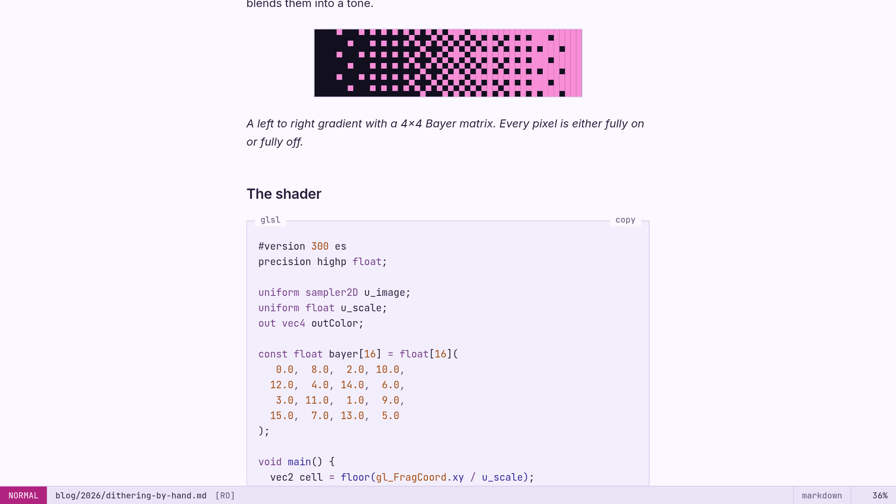
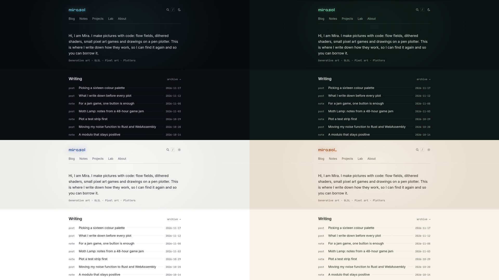
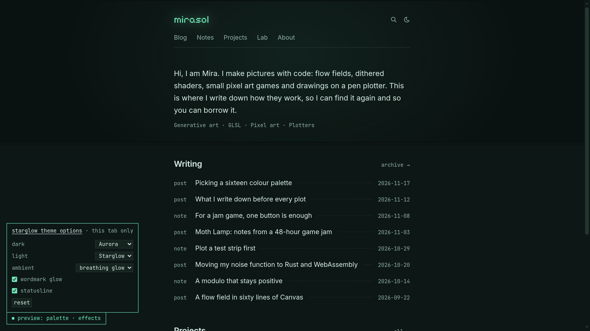

# starglow

A minimal, developer-flavoured Astro theme for blogs, notes and projects.
Dark first, its own colour palettes, a little 2000s glow.

<picture>
  <source media="(prefers-color-scheme: light)" srcset=".github/assets/home-light.png">
  
</picture>

**[Live demo](https://glowing-space.github.io/starglow/)** · [Releases](https://github.com/glowing-space/starglow/releases)

## Features

- Posts, notes and projects, with tags and related content
- Banded header with an optional ambient glow and a pixel wordmark
- Labelled code, table and callout blocks; GitHub alerts; MDX; optional Obsidian syntax
- Vim-style statusline with h/j/k/l, 88x31 footer badges, a terminal-style 404
- Pagefind search, RSS, sitemap, generated Open Graph images, JSON-LD
- 4 dark and 5 light palettes, or your own, checked for WCAG AA; a live preview panel for demos
- Almost no client JavaScript; a static `dist/` for any host
- One typed, validated config file: a typo fails the build and names the key you meant

## Screenshots

| Dark                                                                                                                                                                                                       | Light                                                                                 |
| ---------------------------------------------------------------------------------------------------------------------------------------------------------------------------------------------------------- | ------------------------------------------------------------------------------------- |
|  |  |






## Get started

```bash
git clone https://github.com/glowing-space/starglow.git my-site
cd my-site
git remote rename origin starglow   # keeps upgrades a merge, see UPGRADING.md
pnpm install
pnpm dev                            # http://localhost:4321/
```

Edit `starglow.config.ts` (hover a key for its docs), set `SITE_URL` to your origin, replace the demo content in `src/content/` and push: the GitHub Pages workflow deploys `dist/`.

## Contributing

Issues and pull requests are welcome. Read [CONTRIBUTING.md](CONTRIBUTING.md)
first; security issues go through [SECURITY.md](SECURITY.md).

## Credits


Made by [Andrii Filiurskyi](https://github.com/filiurskyi), a
[glowing.space](https://glowing.space) project.

Originally inspired by [AstroPaper](https://github.com/satnaing/astro-paper).
Thanks, Sat Naing. Fonts: Inter, JetBrains Mono and Pixelify Sans (SIL OFL). See [NOTICE](NOTICE).

## Licence

[MIT](LICENSE). Keeping the "powered by starglow" footer credit is
appreciated, not required.
