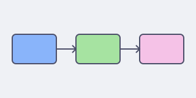

# Writing posts

What Markdown and MDX render to in starglow.

## Writing code blocks

Fenced code blocks are highlighted by Shiki at build time, so no highlighting script runs in the browser. Each block gets a small label with its language and a copy button. Write the language after the opening fence:

````md
```rust
fn main() {}
```
````

A block without a language, or with `text`, gets the label `text`. Code blocks are left out of the search index, so search results quote your prose, not your code.

### Shell

```bash
#!/usr/bin/env bash
set -euo pipefail

for f in ./*.log; do
  gzip -9 "$f"
done
```

### TypeScript

```ts
type Post = { slug: string; title: string; draft?: boolean };

export function visible(posts: Post[]): Post[] {
  return posts.filter(post => !post.draft);
}
```

### Rust

```rust
fn main() {
    let words = ["alpha", "beta", "gamma"];
    for (i, w) in words.iter().enumerate() {
        println!("{i}: {w}");
    }
}
```

### Python

```python
from pathlib import Path


def count_lines(path: Path) -> int:
    with path.open(encoding="utf-8") as handle:
        return sum(1 for _ in handle)
```

### YAML

```yaml
services:
  dev:
    image: example-dev:local
    ports:
      - "4321:4321"
```

### Long lines

Long lines scroll inside their block instead of wrapping or widening the page. Try this one on a phone:

```text
This is one very long line of text that keeps going well past two hundred characters, so that horizontal scrolling inside the code block can be checked on a phone, a tablet and a desktop browser alike.
```

A long shell pipeline:

```bash
find /var/log -type f -name '*.log' -mtime -7 -print0 | xargs -0 grep -h 'ERROR' | sed -E 's/^[0-9-]+ [0-9:]+ //' | sort | uniq -c | sort -rn | head -n 20 | awk '{ printf "%-6s %s\n", $1, substr($0, index($0, $2)) }'
```

Inline code such as `pnpm build` uses the same monospace font at body size.

## Writing callouts

Callouts use the GitHub alert syntax, so the same Markdown renders on GitHub too:

```md
> [!TIP]
> Optional information to help a reader be more successful.
```

### Alert types

> [!NOTE]
> Highlights information that readers should take into account, even when skimming.

> [!TIP]
> Optional information to help a reader be more successful.

> [!IMPORTANT]
> Crucial information necessary for readers to succeed.

> [!WARNING]
> Critical content demanding immediate reader attention because of potential risks.

> [!CAUTION]
> Negative potential consequences of an action.

### Custom title

A title can follow the alert type on the same line:

> [!TIP] Faster builds
> Run `pnpm build:site` to skip `astro check` while you iterate on styles.

### Several paragraphs and inline code

> [!NOTE] Two paragraphs
> The first paragraph mentions `inline code`, so its colours and size can be checked in both themes.
>
> The second paragraph checks the spacing between paragraphs inside a callout.

#### Headings get anchors

Every heading from `##` down gets a link anchor at build time. Hover a heading to see it.

## Writing tables

Tables use the usual Markdown pipe syntax. Colons in the separator row set the alignment of each column.

### Small table

| Command       | What it does                  |
| :------------ | :---------------------------- |
| `pnpm dev`    | Runs the dev server.          |
| `pnpm build`  | Builds the site into `dist/`. |
| `pnpm verify` | Checks the built site.        |

### Alignment

| Left aligned | Centered | Right aligned |
| :----------- | :------: | ------------: |
| one          |   two    |             1 |
| three        |   four   |            22 |
| five         |   six    |           333 |

### Wide table

A table wider than the text column scrolls sideways inside its box. The page itself never gets wider.

| Left aligned | Centered | Right aligned | First long column                                             | Second long column                                                   | Third long column                                                       | Fourth long column                                                | Notes |
| :----------- | :------: | ------------: | ------------------------------------------------------------- | -------------------------------------------------------------------- | ----------------------------------------------------------------------- | ----------------------------------------------------------------- | ----- |
| alpha        |   beta   |             1 | A fairly long cell of text that forces this column to be wide | Another long cell of text that keeps the row from fitting on a phone | A third long cell of text that keeps widening the table past the column | A fourth long cell of text so that horizontal scrolling is needed | none  |
| gamma        |  delta   |            22 | Short                                                         | Short                                                                | Short                                                                   | Short                                                             | none  |
| epsilon      |   zeta   |           333 | More long text for the first column in this last row          | More long text for the second column in this last row                | More long text for the third column in this last row                    | More long text for the fourth column in this last row             | none  |

## Writing with images

Put images next to the post, in a folder whose name starts with `_`, such as `_assets/`. Astro optimises them at build time, and the underscore keeps the folder out of the content loader.

```md

```

### Figure



_Figure 1: three boxes joined by arrows. A caption is an italic line right under the image._

### Alt text

Every image needs alt text that describes what it shows. `pnpm verify` fails on an image without it. If an image is purely decorative, leave it out of the post instead.

### Social images

A post's social preview image is generated from its title by default. To use your own, put an image next to the post and set `ogImage: ./_assets/cover.png` in the frontmatter.

## Writing in MDX

Name a post `.mdx` instead of `.md` to use MDX. Everything that works in Markdown still works, and you can add expressions and components.

For example, `{6 + 7}` in an MDX post renders as 13.

### Code

```ts
const answer: number = 6 * 7;
console.log(answer);
```

### Callout

> [!NOTE]
> Alerts like this one render the same way in Markdown and MDX posts.

### When to use it

Plain Markdown is easier to read, to diff and to move to another tool later. Reach for MDX only when a post really needs a component.

## Writing in Obsidian

Set `features.obsidian: true` in `starglow.config.ts` to copy posts, notes and projects from an Obsidian vault unchanged. The build converts Obsidian syntax in `.md` files and never rewrites them. MDX files are left alone.

- `[[Note]]`, `[[Note|text]]` and `[[Note#Heading]]` link to the post, note or project with that file name, `title` or alias (case-insensitive). With no match they render as plain text. In a production build, drafts and posts scheduled for later count as no match.
- `![[Note]]` renders as a link, not as an embedded note.
- `![[image.png|alt text]]` embeds an image from `_assets/` next to the file. Copy images there by hand from the vault. A size such as `|400` is ignored. The build fails when the alt text is missing or the file is not in `_assets/`, and on any embed other than an image or a note.
- Obsidian callout types render as the nearest GitHub alert: `abstract`, `summary`, `tldr`, `info`, `todo`, `example`, `quote` and `cite` as NOTE; `hint`, `success`, `check` and `done` as TIP; `question`, `help` and `faq` as IMPORTANT; `attention` as WARNING; `failure`, `fail`, `missing`, `danger`, `error` and `bug` as CAUTION.
- `%%comments%%` are removed. Code blocks and inline code are left as written.
- The Obsidian-only properties `aliases`, `alias`, `cssclasses`, `cssclass`, `publish`, `permalink`, `created` and `modified` are accepted and dropped. Any other unknown property still fails the build. `tags: rust`, `#rust` and an empty `tags:` are accepted; tags must still be lowercase.

### Templates in Obsidian

The files in `templates/` explain every key in YAML comments. Obsidian's Properties editor removes YAML comments, so a template for the Templater plugin works better without them:

- Write only the required keys and the ones you fill in: `title`, `description`, `pubDatetime` and `draft` for a post; `title` and `draft` for a note; `title`, `description`, `status` and `draft` for a project.
- Leave an optional key out rather than empty. An empty `description:` or `githubUrl:` is `null`, and the strict schema rejects it.
- Write `pubDatetime` with an offset: `<% tp.date.now("YYYY-MM-DDTHH:mm:ssZ") %>`.
- Keep `draft: true` in the template and switch it to `false` when the entry is ready.
- A list of the remaining optional keys fits in a `%%comment%%` in the body of a post or note; the build removes it. A project must have no body at all, not even a comment.

A post template that asks for the title, description and tags:

```text
<%*
const ask = async q => ((await tp.system.prompt(q)) ?? "").trim();
const title = (await ask("Title")) || tp.file.title;
const description = await ask("Description");
const tags = (await ask("Tags")).split(/[\s,]+/).filter(Boolean);
-%>
---
title: <% JSON.stringify(title) %>
description: <% JSON.stringify(description) %>
pubDatetime: <% tp.date.now("YYYY-MM-DDTHH:mm:ssZ") %>
tags: [<% tags.join(", ") %>]
draft: true
---

%% optional keys: modDatetime, hideToc, hideEditPost, ogImage, timezone, canonicalUrl, syndication, author %%
```

For a project, ask for the status with `tp.system.suggester(["active", "maintained", "archived"], ["active", "maintained", "archived"])`. Copy the finished file to the right folder in the repository: a post into `src/content/blog/<year>/`, where the year matches `pubDatetime`.

`./dev.sh ci` checks the formatting of `src/content/` with Prettier. If Obsidian's formatting gets in the way, add `/src/content/` to `.prettierignore`.
