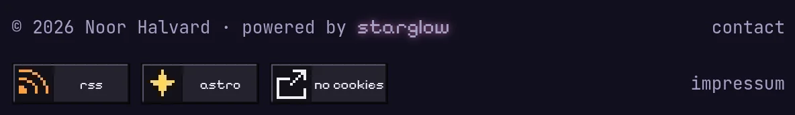

I had a "Netscape Now!" button on my first homepage. It was 88 pixels wide and 31 tall, like nearly every button of that era, and I've wanted a row of them under a site ever since. starglow finally gave me an excuse.



_The footer of this site._

## Why not GIFs

The originals were GIFs. I tried that first and gave up within an evening. A GIF badge is a fixed bitmap, so each one needed redrawing when I wanted a different label. They also blur on a high-density screen unless you remember `image-rendering`, and they can't take a colour from CSS.

An SVG is 88x31 user units, crisp at any zoom, and its fills can be CSS variables.

## Icons as text

Each icon is an 11x11 grid written as strings in `src/utils/badges.ts`. A `#` is a lit cell. This is the RSS one:

```ts
rss: {
  label: "rss",
  title: "RSS feed",
  bitmap: [
    "#####......",
    ".....##....",
    ".......#...",
    "###.....#..",
    "...##....#.",
    ".....#...#.",
    "##....#...#",
    "###...#...#",
    "###...#...#",
    "...........",
    "...........",
  ],
},
```

I drew most of them in a text editor with a monospace font zoomed to 300%. It's slower than a pixel editor for about five minutes, and after that it's faster, because I can diff them.

## From bitmap to rectangles

Drawing one `<rect>` per lit cell works, but the GitHub icon alone has 72 lit cells. The component merges each horizontal run of `#` into one rectangle instead, which brings GitHub down to 20:

```ts
export function bitmapRuns(bitmap: string[]): [number, number, number][] {
  const runs: [number, number, number][] = [];
  bitmap.forEach((row, y) => {
    for (const match of row.matchAll(/#+/g)) {
      runs.push([match.index ?? 0, y, match[0].length]);
    }
  });
  return runs;
}
```

Every cell is 2x2 units, and the icon sits in a 28x27 well on the left. The bevel is four 1px rectangles, a light one top and left and a dark one bottom and right, which is how every Windows 95 button got its depth. `shape-rendering="crispEdges"` keeps the edges from being anti-aliased into mush.

## Labels that don't fit

The label is a `<text>` element in the pixel face at 10px. Up to nine characters fit in the 56-unit text area. Longer labels, like "no cookies", get squeezed:

```ts
const squeeze =
  text.length > 9 ? { textLength: 52, lengthAdjust: "spacingAndGlyphs" } : {};
```

`spacingAndGlyphs` narrows the letters as well as the gaps. Real 88x31 buttons did the same thing by hand, with worse results.

## Colour and accessibility

Badges look the same in every palette, like the originals did. Only the icon colour changes per badge, from a `--badge-<type>` token such as `--badge-rss`. Adding a badge type is one bitmap and one token.

The SVG itself is `aria-hidden`. A screen reader gets the link's `title` from a visually hidden span instead, so it hears "RSS feed" rather than a list of rectangles. I went through the footer with Orca in February to check, and updated this post with what it reads: one link per badge, by name.
