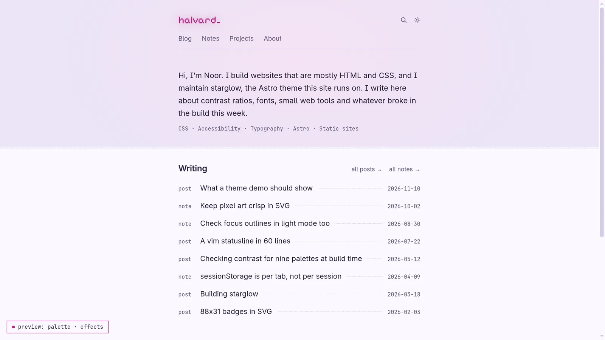
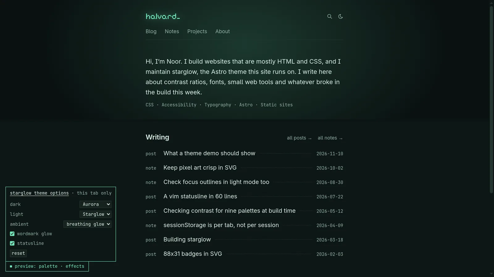

starglow is the theme this site runs on. It started in a branch called `new-look` that I meant to finish in a weekend. That was a long time and a lot of weekends ago.

_The demo's home page in the dark starglow palette._

## Starting from AstroPaper

I didn't start from nothing. AstroPaper by Sat Naing had most of the plumbing I wanted: content collections, tags, pagination, an RSS feed, generated Open Graph images. I forked it, and for the first month I mostly deleted things.

What stayed is the shape of the project. Almost none of the styling did, and starglow doesn't follow AstroPaper's releases any more. When I need something from upstream I copy it by hand.

## The rules I set early

I wrote these on an index card before touching the CSS, and they're still in the repository's notes for contributors:

- Zero border radius, 1px borders, a 4px spacing grid.
- A short list of font sizes. The build fails on any other size.
- Dark mode first. Light mode is a separate design, not an inverted one.
- Almost no client JavaScript and no framework islands.

The type scale rule sounds fussy. The first time the check ran, it found stray sizes in CSS I was sure I had cleaned up.

## Two modes, two palettes

Most themes pick a dark palette and derive the light one. I tried that and the light version always looked like a printout of the dark one. So the palettes are chosen separately: four dark ones and five light ones, in any combination, all in one file, `src/palettes.ts`.

_Light mode uses its own starglow palette, not an inverted dark one._

Every palette has to pass WCAG AA contrast for all of its text colours, and the build checks that. I wrote up how in a [separate post](../checking-contrast-for-nine-palettes/).

## Notes and projects

AstroPaper has posts. I wanted two more things:

- Notes, for the two-paragraph findings I'd never write a full post about. They have no date field; the date comes from git.
- Projects, one Markdown file each with frontmatter only. A project with a body fails the build, which annoyed me at first and now saves me from writing half a README in the wrong place.

## The preview panel

The demo has a small "preview" tab in the corner. It opens a panel where you can switch the palettes, the header light, the wordmark glow and the statusline, and see the result straight away.

_The preview panel with the dark aurora palette selected._

It's off by default and meant for theme demos like this one. The choices live in `sessionStorage`, so they last for one browser tab and nothing is stored anywhere else. A small inline script applies them before first paint, otherwise every page load flashes the default palette for a frame.

## What I'd do differently

I'd write the build checks first. For a long time I checked things by looking at them, and looking at nine palettes in two modes on four page types is how bugs get through.

I'd also have kept the statusline out of the first release. It took more evenings than search did, and I'm still not sure anyone uses `hjkl` on a blog. I like it, though, so it stays.
